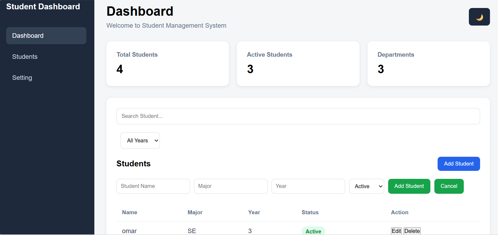

# Student Management Dashboard
A web application for managing student information.
This project was created as a web development practice project.

## Features
-Add new students

-Edit student information

-Delete students

-Search students by name

-Filter students by year

-Form validation

-Prevent duplicate students

-Student statistics

-Dark mode

-Save data using Local Storage

-Responsive design

## Technologies
-HTML

-CSS

-JavaScript

## How to Run
1.Clone the repository.

2.Open the project folder in Visual Studio Code.

3.Open `index.html` in your browser.

## Project Preview

## project Structure

-`index.html` -Main page structure

-`style.css` -Website styling

-`script.hs` -JavaScript functionality

-`screenshot.png` -Project preview

### API Product Search

A JavaScript project that uses a REST API to search and display products.